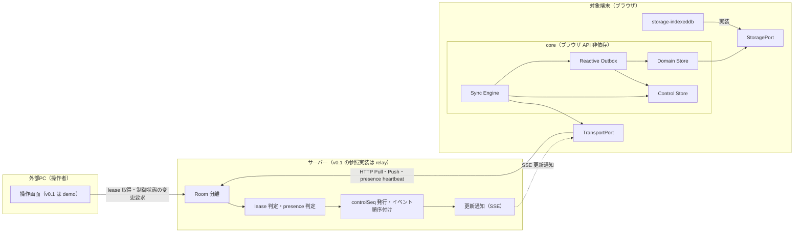

# 基本設計書（基本仕様・システム全体アーキテクチャ定義）
**状態同期基盤 v0.1 MVP：対象端末のローカル状態と、外部PCの制御状態による動的送信制御**

---

## 1. 概要と基本方針

### 1.1 システム目的と対象範囲

ブラウザ側（対象端末）に状態の正本と決定論的な計算ロジックを持たせ、外部PCの画面操作に由来する制御状態に応じて、データ送信を動的に制御する。UI フレームワークに依存しない TypeScript の最小核として、Git サブモジュールで親プロジェクトへ組み込める構成にする。要求の正本は [最小要件定義書](../features/CSU-REQ-001_最小要件定義書.md) である。

- **対象範囲**: `core`、`storage-indexeddb`、`relay`、`demo` の4パッケージの責務と境界。対象端末と外部PCとサーバーのあいだの制御の流れ。
- **対象外範囲**: 要件定義書 §5 の後続課題（#1〜#10）。Web Worker 隔離、複数端末の競合ポリシー、リベース、Mailbox、OPFS、スナップショット、アップキャスター、認可、デバウンス、UI バインディングは扱わない。
- **利用者・外部システム**:
  - 対象端末: 状態を保持して送信する側のブラウザ。
  - 外部PC: 制御状態を変更する操作者側のクライアント（本書での用語の使い方。CONTEXT.md への登録は #11 で扱う）。
  - 親プロジェクト: `core` と `storage-indexeddb` をサブモジュールとして組み込む側。
- **前提・制約**: 要件定義書の CN-01〜CN-05。ブラウザタブを閉じている間の処理は対象外。
- **主要な非機能要件**: 下表。ID は要件定義書のものをそのまま使う。

| ID     | 区分   | 要件                                                                     | 目標値・基準                                     | 測定方法・確認先                                                                 | 正本                                                           |
| :----- | :----- | :----------------------------------------------------------------------- | :----------------------------------------------- | :------------------------------------------------------------------------------- | :------------------------------------------------------------- |
| NFR-01 | 保守性 | TypeScript `strict: true` を満たし、境界のメッセージの型契約を定義する。 | 型検査がエラーなしで通る。                       | [環境・開発基盤仕様書](../setup/CSU-ENV-001_環境・開発基盤仕様書.md) の QG-002。 | [要件定義書 NFR-01](../features/CSU-REQ-001_最小要件定義書.md) |
| NFR-02 | 可用性 | タブ閉鎖中のバックグラウンド処理と常駐応答は対象外とする。               | 対象外であることが文書に明記されている。         | 本書 §1.1。                                                                      | [要件定義書 NFR-02](../features/CSU-REQ-001_最小要件定義書.md) |
| NFR-03 | 保守性 | `schemaVersion` を必須とし、不一致時は状態を変えずにエラーで停止する。   | 不一致メッセージの受信後も永続状態が変化しない。 | IF/API仕様書の機能テスト要件。                                                   | [要件定義書 NFR-03](../features/CSU-REQ-001_最小要件定義書.md) |

### 1.2 アーキテクチャ基本原則と課題解決

| #    | 課題・ボトルネック                                       | 優先度 | 解決方針・選定技術                                                                                 | 選定理由・トレードオフ                                                                             | 担当コンポーネント  | 関連文書                                                             |
| :--- | :------------------------------------------------------- | :----: | :------------------------------------------------------------------------------------------------- | :------------------------------------------------------------------------------------------------- | :------------------ | :------------------------------------------------------------------- |
| 1    | ドメイン状態と送信制御が結合すると、再計算と検証が難しい |   高   | Domain Store と Control Store を分離する。状態遷移は Reducer と追記型イベントログで管理する。      | 決定論的に再現できる。ストアが2つになり、結合点（Reactive Outbox）の設計が必要になる。             | C-001、C-002、C-003 | [要件定義書 FR-01、FR-02](../features/CSU-REQ-001_最小要件定義書.md) |
| 2    | 古い制御状態に基づく送信が混ざる                         |   高   | サーバーが発行する `controlSeq` を送信に付け、サーバーが古い値を拒否する。                         | 拒否判定が1か所に集まる。制御状態の変更にはサーバーとの通信が必要になる。                          | C-003、C-008        | [ADR-007](../adr/ADR-007_controlSeq発行元とアダプター分離.md)        |
| 3    | 再接続時に古い制御状態で送信してしまう                   |   高   | Control-First Sync。再接続時は制御状態の Pull を先に完了し、その後に Outbox を評価して Push する。 | 順序が単純で検証しやすい。再接続直後に Pull の往復が1回増える。                                    | C-004               | [要件定義書 FR-04](../features/CSU-REQ-001_最小要件定義書.md)        |
| 4    | 親プロジェクトの環境差でサブモジュールが壊れる           |   高   | `core` はポートのインターフェースだけを持ち、ブラウザ API 依存の実装は別パッケージに分ける。       | `core` を環境非依存に保てる。パッケージが増え、親プロジェクトは組み込む対象を選ぶ必要がある。      | C-001〜C-007        | [要件定義書 CN-01、CN-02](../features/CSU-REQ-001_最小要件定義書.md) |
| 5    | ロック判定の場所が分かれると、拒否の根拠が曖昧になる     |   高   | ロックの判定は、サーバーが一元的に行う（§2.3 の判断 D-01）。                                       | クライアントの判定は改ざんでき、時刻も一元的に持てない。クライアントの事前チェックは UX 用に限る。 | C-008               | 本書 §2.3                                                            |

### 1.3 本書のSSOT範囲と文書境界

- **本書の正本範囲**: `system_architecture`。目的、コンポーネントの責務と依存方向、信頼境界、横断的な方針。
- **IF/API仕様書との境界**: 境界を越えるメッセージの形式、エラーコード、認証、互換性は [IF/API仕様書](./CSU-IF-001_IF仕様書.md) を正本とする。本書は境界の位置と方針だけを定める。
- **[詳細設計書（DD）](./CSU-DD-001_詳細設計書.md)との境界**: 関数契約、DTO、状態遷移条件、TTL と再試行の具体値は DD を正本とする。
- **[データ構造仕様書（DS）](./CSU-DS-001_データ構造仕様書.md)との境界**: イベントログの保存形式、スキーマ、移行は DS を正本とする。
- **他文書との関係**: 要求は要件定義書、判断理由は ADR を正本とし、本書の方針を上書きしない。
- **全体ルール**: 文書分類、Frontmatter、ライフサイクル、矛盾時の解決は [`docs/README.md`](../README.md) を正本とする。

---

## 2. システム全体アーキテクチャとコンポーネント分離

### 2.1 全体構造とデータフロー

パッケージ構成と、通信の方向を示す。破線は更新通知（サーバーから対象端末への片方向）である。

### 2.2 コンポーネント責務マッピング

| コンポーネントID | コンポーネント名                             | 担当領域・主要責務                                                                                                                     | 依存先・依存方向 / 公開インターフェース                                                                                          | 関連詳細設計書                                                                 |
| :--------------- | :------------------------------------------- | :------------------------------------------------------------------------------------------------------------------------------------- | :------------------------------------------------------------------------------------------------------------------------------- | :----------------------------------------------------------------------------- |
| C-001            | Domain Store（`core`）                       | ドメイン状態の正本。Reducer とイベントログで状態を遷移させ、復元する。                                                                 | `StoragePort` に依存する。状態の参照と、イベントの追記を公開する。                                                               | [DD](./CSU-DD-001_詳細設計書.md) F-001                                         |
| C-002            | Control Store（`core`）                      | 制御状態（送信対象フィルタ、現在の操作権限者）と、サーバーから受け取った最新の `controlSeq` を保持する。ドメイン状態とは分離する。     | 依存先なし。制御状態の参照と更新の反映を公開する。                                                                               | [DD](./CSU-DD-001_詳細設計書.md) F-002                                         |
| C-003            | Reactive Outbox（`core`）                    | 未送信イベントと Control Store の最新状態を突き合わせ、条件に合うイベントだけを、`controlSeq` を付けて送信対象にする。                 | C-001、C-002 に依存する。送信対象の評価を公開する。                                                                              | [DD](./CSU-DD-001_詳細設計書.md) F-003                                         |
| C-004            | Sync Engine（`core`）                        | Control-First Sync の手順を制御する。接続・再接続時に制御状態を取得し、その後に Outbox の評価と送信を行う。presence heartbeat を送る。 | C-002、C-003、`TransportPort` に依存する。                                                                                       | [DD](./CSU-DD-001_詳細設計書.md) F-004                                         |
| C-005            | `StoragePort`（`core` のインターフェース）   | 永続化の抽象。責務は、イベントの追記、順序付きの読み出し、送信状態の更新の3つとする（D-03）。保存形式は定めない（DS が正本）。         | `core` が定義し、C-007 が実装する。                                                                                              | [DD](./CSU-DD-001_詳細設計書.md) F-001、[DS](./CSU-DS-001_データ構造仕様書.md) |
| C-006            | `TransportPort`（`core` のインターフェース） | 通信の抽象。制御状態の取得、イベントの送信、heartbeat の送信、更新通知の受信を隠蔽する。プロトコルの実装詳細は `core` に持ち込まない。 | `core` が定義する。HTTP と SSE の実装は、実装パッケージ側に置く。置き場所（パッケージ）は未決で、要件定義書の OP-08 で管理する。 | [DD](./CSU-DD-001_詳細設計書.md) F-004                                         |
| C-007            | `storage-indexeddb`                          | `StoragePort` の IndexedDB 実装。ブラウザ API に依存する。                                                                             | `core` の `StoragePort` に依存する。`core` からは参照されない。                                                                  | [DS](./CSU-DS-001_データ構造仕様書.md)                                         |
| C-008            | サーバー（v0.1 の参照実装は `relay`）        | Room 単位の分離、`controlSeq` の発行と検証、イベントの順序付け、lease と presence の判定、更新通知。                                   | 対象端末と外部PCから、IF/API仕様書の契約で呼ばれる。`core` には依存しない。                                                      | [DD](./CSU-DD-001_詳細設計書.md) F-005〜F-008                                  |
| C-009            | `demo`                                       | 2画面（対象端末と外部PC）の動作確認用。v0.1 の外部PC側の操作画面を兼ねる。                                                             | `core`、`storage-indexeddb`、`relay` を利用する。他から参照されない。                                                            | 該当なし（動作確認用）                                                         |

依存方向は、`demo` から `core`、`storage-indexeddb`、`relay` へ向かう。`storage-indexeddb` は `core` に依存し、`core` は他のパッケージに依存しない。循環はない。

### 2.3 横断方針

| ID   | 判断                                                                                                                                                                                                                                                                                                                                                                                                                                                                         | 理由                                                                                                                                                                                                                                                                                                                                                                                                                                                                                                                                             | 反映先                                                        |
| :--- | :--------------------------------------------------------------------------------------------------------------------------------------------------------------------------------------------------------------------------------------------------------------------------------------------------------------------------------------------------------------------------------------------------------------------------------------------------------------------------- | :----------------------------------------------------------------------------------------------------------------------------------------------------------------------------------------------------------------------------------------------------------------------------------------------------------------------------------------------------------------------------------------------------------------------------------------------------------------------------------------------------------------------------------------------- | :------------------------------------------------------------ |
| D-01 | **ロックの判定は、サーバーが行う。** クライアント側の判定は、送信前の事前チェック（UX 用）に限り、拒否の根拠にはしない。拒否は外部に返すエラー応答で、エラーコードは IF/API仕様書で定義する。ADR-007 の「拒否判定をサーバーに集める」の延長なので、新しい ADR は作らない。                                                                                                                                                                                                   | `controlSeq` の発行と拒否判定がサーバーに集まっており、ロックだけをクライアントに置くと判定の場所が2か所になる。クライアントの判定は改ざんでき、lease の TTL 切れを判定する時刻も、サーバーだけが一元的に持てる。lease による保持者の変更は制御状態の変更として扱い、`controlSeq` を発行する（保持者が変わったときだけ。RENEW では発行しない）。そのため、保持者が変わると、その間に Outbox が送った Push は1回 `STALE_CONTROL_SEQ` で拒否され、対象端末は Pull し直してから Push を再開する。保持者の変更はまれなので、このコストは受け入れる。 | 要件定義書 OP-05、OP-06、FR-02。IF/API仕様書 §4.5、§4.6。     |
| D-02 | **ハートビートは2種類に分ける。** lease heartbeat は操作権限者がロックの保持を続けるための通知、presence heartbeat は対象端末が接続中であることの通知とする。TTL は、それぞれ独立に設定する。具体値は DD で定める。                                                                                                                                                                                                                                                          | 送り手も、切れたときの意味も異なる。TTL を共有すると、片方の調整がもう片方に影響する。                                                                                                                                                                                                                                                                                                                                                                                                                                                           | 要件定義書 FR-02、FR-05。IF/API仕様書 §4。                    |
| D-03 | **`StoragePort` の責務は、イベントの追記、順序付きの読み出し、送信状態の更新の3つとする。** `events` は追記だけで、更新も削除もしない（不変条件）。更新できるのは、送信状態の `PENDING` → `SENT` だけである。イベントログの保存形式は DS で定める。                                                                                                                                                                                                                          | 保存形式が決まらなくても、`core` のロジックと `StoragePort` の境界を先に固定できる。送信状態（未送信か送信済みか）は、再接続後に未送信のイベントを選ぶために必要で、イベントと同じ永続化の単位（トランザクション）で扱うほうが、不整合が起きにくい。v0.1 では、別のポート（例: `DeliveryPort`）に分ける理由が足りない。                                                                                                                                                                                                                          | 要件定義書 FR-01。[DS](./CSU-DS-001_データ構造仕様書.md) §2。 |
| D-04 | **オフラインの判定は、サーバーが行う。** 更新通知の接続（v0.1 では SSE）があり、かつ presence heartbeat の TTL が切れていない対象端末をオンラインとする。                                                                                                                                                                                                                                                                                                                    | 対象端末の状態を、時刻を一元的に持つサーバーが判断する。通知方式が変わっても、定義は「更新通知の接続」で成り立つ。                                                                                                                                                                                                                                                                                                                                                                                                                               | 要件定義書 FR-05。IF/API仕様書 §4。                           |
| D-05 | **TTL と再試行の具体値は、DD で定める。** 本書では値を決めない。                                                                                                                                                                                                                                                                                                                                                                                                             | 実装方針が固まってから、検証できる形で決める。                                                                                                                                                                                                                                                                                                                                                                                                                                                                                                   | [DD](./CSU-DD-001_詳細設計書.md) §1.3。                       |
| D-06 | **制御状態は Room 単位で1つ持つ。オンラインかどうかは `targetId` ごとに判定する。** 制御状態の変更は Room 全体に適用する。変更の要求に含める `targetId` は、変更を届けたい端末で、その端末がオフラインなら拒否し、変更は適用しない。同じ Room の他の端末がオフラインでも拒否しない。それらの端末は、再接続時の Control-First Sync で最新の制御状態を受け取る。端末ごとに送信を変えたい場合は、送信対象フィルタの条件に端末の識別子を含める（フィルタの形式は DD で定める）。 | 制御状態を端末ごとに持つと、`controlSeq` の単位と順序の保証が複雑になる。Room 単位なら、`controlSeq` の発行と拒否判定が1つの流れで済む。オンライン判定は、端末ごとに接続と presence が異なるため、`targetId` ごとに行う。                                                                                                                                                                                                                                                                                                                        | 要件定義書 OP-07、FR-02、FR-05。IF/API仕様書 §4.1、§4.6。     |

---

## 3. 動作前提およびシステム境界

### 3.1 実行前提環境

- **対応OS**: 特定の OS を前提にしない。
- **ランタイム要件**: TypeScript（`strict: true`）。ブラウザと Node の対象バージョンは、[環境・開発基盤仕様書](../setup/CSU-ENV-001_環境・開発基盤仕様書.md) §4.1 を正本とする。
- **依存管理・パッケージマネージャーの正本**: [TypeScript 環境構築](../setup/typescript_setup.md) と [依存管理](../setup/dependency_management.md)。
- **外部依存ツール**: `core` はランタイム依存を持たない（Zero-Dependency Core）。
- **実行エントリポイント**: v0.1 では `demo`（2画面）と `relay`。起動方法は DD または運用手順書で定める。
- **品質目標・品質ゲート**: 型検査、テストなどの実行条件と合格基準は、[環境・開発基盤仕様書](../setup/CSU-ENV-001_環境・開発基盤仕様書.md) §4.4 を正本とする。

### 3.2 安全回路・システム境界方針

- **外部アクター・外部システム**: 外部PC（操作者）、対象端末（ブラウザ）、親プロジェクト。
- **入出力と信頼境界**: 対象端末と外部PCからサーバーへの入力は、信頼できない入力として扱う。サーバーは、メッセージの形式、`schemaVersion`、`controlSeq`、lease を検証する。
- **認証・認可境界**: v0.1 は認証を持たず、信頼できるネットワークでの単体検証だけを想定する。認可（認証トークン、テナント分離、サーバー側不変条件の検証）は [#8](https://github.com/xzyozi/control-sync-ui/issues/8) で、インターネット公開の前に追加する。lease を持たない操作は、認可とは別に、サーバーがロックの判定で拒否する（D-01）。
- **タイムアウトと再試行制御**: lease、presence、HTTP 呼び出しのタイムアウトと再試行の上限は、DD で定める（D-05）。
- **排他制御・競合防止**: 制御状態の変更は、単一の排他ロック（Exclusive Lease Lock）で守る。複数の操作者の競合ポリシーは、後続課題 [#2](https://github.com/xzyozi/control-sync-ui/issues/2) とする。
- **失敗時保全契約**: `schemaVersion` の不一致を検出したら、メッセージを適用せず、永続状態を変更せず、エラーを呼び出し元へ通知する（要件定義書 NFR-03）。`STALE_CONTROL_SEQ` で拒否された送信のイベントは、破棄せず、未送信のまま保持し、制御状態を取得し直してから再評価する（[DD §3.2](./CSU-DD-001_詳細設計書.md)）。
- **機密情報・監査ログ方針**: v0.1 は機密データを扱わない前提とする。認可と合わせて #8 で定める。

---

## 4. 基本設計における変更管理方針

- **拡張時のルール**: `core` にブラウザ API やプロトコルの実装を持ち込まない。新しい実装は、ポートのインターフェースを実装する別パッケージとして追加する。ロックと `controlSeq` の判定は、サーバーに集める。
- **仕様の決定権 (SSOT)**: 基本設計方針は本書を正本とし、メッセージ契約は IF/API仕様書、関数契約と状態遷移は DD、永続化スキーマは DS を正本とする。文書全体の分類とライフサイクルは [`docs/README.md`](../README.md) を参照する。
- **変更影響の確認方法**: 本書の責務や境界を変える場合は、先に要件定義書と ADR を確認し、IF/API仕様書、DD、DS の順に更新する。判断の理由が変わる場合は、既存 ADR を削除せず、後継 ADR を作成する。

---

## 5. 作成完了チェック

- [x] 対象範囲・対象外範囲・利用者・前提を記入した。
- [x] 主要な非機能要件を表に記入し、各要件に目標値・測定方法・正本を設定した（品質ゲートは参照のみ）。
- [x] `document_role`、`ssot_scope`、`status`、`owner`をFrontmatterへ設定した。
- [x] 課題ごとに優先度、選定理由、トレードオフ、担当、関連文書を記入した。
- [x] Mermaid図のサンプル名・仮ラベルを実際の構成へ置換した。
- [x] 全コンポーネントの責務、依存方向、公開インターフェース、関連する詳細設計書へのリンクを記入した。
- [x] 実行環境、依存管理の正本、品質目標と品質ゲートの参照先を記入した。参照先は環境・開発基盤仕様書（CSU-ENV-001）である。
- [x] 外部システム、信頼境界、認証・認可、失敗時保全を記入した。
- [x] 未置換の `[ ... ]`、`YYYY-MM-DD`、サンプル固有名が残っていない。

---

## 6. 改訂履歴 (Change Log)

| 版数    | 改訂日     | 変更者 | 変更内容・変更理由 (Why)                                                                                                                                                                                                                                                                                                                                                |
| :------ | :--------- | :----- | :---------------------------------------------------------------------------------------------------------------------------------------------------------------------------------------------------------------------------------------------------------------------------------------------------------------------------------------------------------------------- |
| Rev.1.0 | 2026-11-26 | xzyozi | 新規作成（初版制定）                                                                                                                                                                                                                                                                                                                                                    |
| Rev.1.1 | 2026-11-27 | xzyozi | レビュー指摘の反映。D-01 に、lease による保持者の変更でも `controlSeq` を発行する方針と、Push が1回拒否されるコストを追記。D-06（制御状態は Room 単位、オンライン判定は `targetId` ごと）を追加。NFR-03 の正本を要件定義書に変更。                                                                                                                                      |
| Rev.1.2 | 2026-11-28 | xzyozi | DD（CSU-DD-001）、DS（CSU-DS-001）、環境・開発基盤仕様書（CSU-ENV-001）の作成に伴い、「未作成」の記述を参照に置き換え。コンポーネントと DD の機能 ID の対応を追加。`TransportPort` の実装の置き場所は未決と明記（OP-08）。D-03 で `StoragePort` の責務に送信状態の更新を追加（`events` は追記だけという不変条件を維持）。拒否されたイベントの扱いを確定済みとして更新。 |
