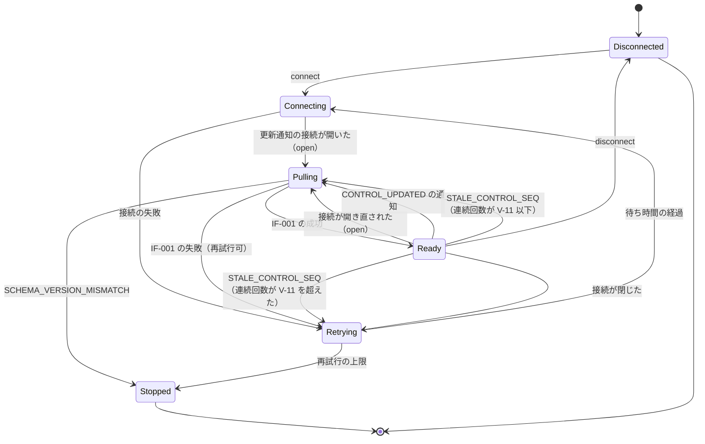
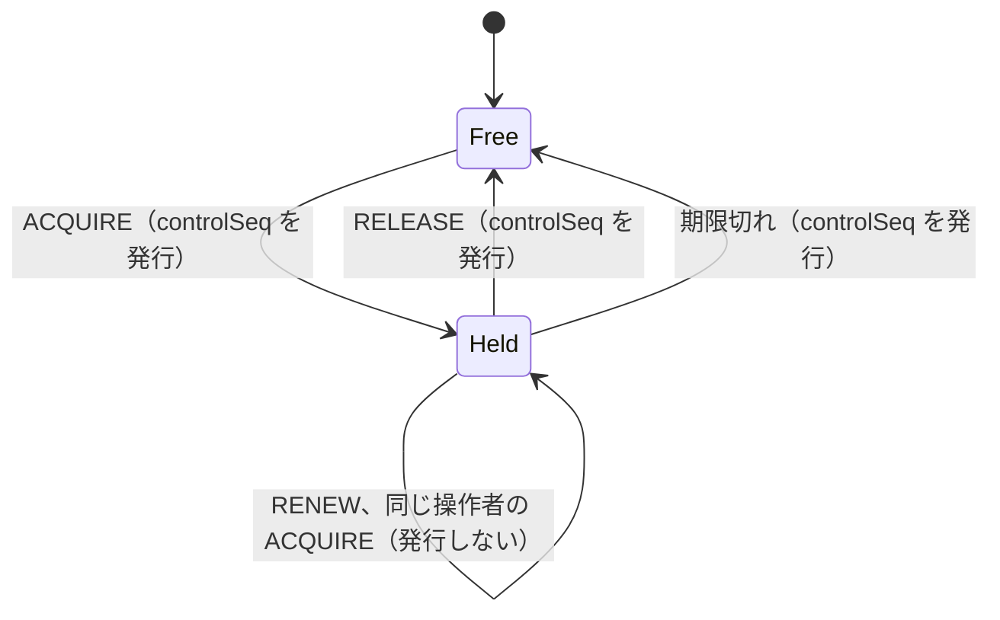
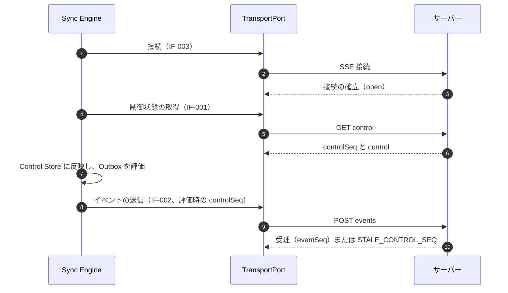

# 詳細設計書（機能・モジュール制御仕様）
**状態同期基盤 v0.1 MVP：Domain Store、Control Store、Reactive Outbox、Sync Engine、サーバー（`relay`）の制御仕様**

---

## 1. 概要とSSOT境界

### 1.1 モジュールの目的

[基本設計書](./CSU-BD-001_基本設計書.md) のコンポーネント C-001〜C-008 を、機能単位の処理手順、DTO、状態遷移、具体値に具体化する。BD と IF が「DD で定める」とした事項（TTL、再試行、`sendFilter` の形式、`requestId` の保持期間、イベントの再評価）を、本書で確定する。

### 1.2 単一責任範囲 (SSOT) とデータ境界

- **本書の正本範囲**: `module_behavior`。関数の呼び出し順序、制御フロー、状態遷移、エラー対処契約、TTL・再試行の具体値。
- **データ境界 (DTO vs DAO)**: 本書はメモリ上の DTO を管理する。保存形式は [DS](./CSU-DS-001_データ構造仕様書.md) を正本とする。
- **BDとの関係**: 責務、境界、横断方針（D-01〜D-06）は BD を正本とする。
- **IFとの関係**: 外部に公開するメッセージ、エンドポイント、エラーコードは [IF/API仕様書](./CSU-IF-001_IF仕様書.md) を正本とする。本書は、公開範囲が「外部公開」の機能について、IF-ID で対応付ける。
- **他文書へ委譲する情報**: 品質ゲートは [環境・開発基盤仕様書](../setup/CSU-ENV-001_環境・開発基盤仕様書.md)、テストケースと実行結果はテスト計画・結果報告書（未作成）を正本とし、本書へ再掲しない。
- **責務の対象外**: UI、認証・認可（#8）、複数操作者の競合ポリシー（#2）、Mailbox（#4）。
- **矛盾時の扱い**: 該当する `ssot_scope` の正本を更新し、関連文書を追従させる。

### 1.3 本書で確定する具体値

実装の既定値である。値の変更は、本書の改訂で行う。

| ID   | 項目                                   | 値                                                                                                                       | 根拠                                                                     |
| :--- | :------------------------------------- | :----------------------------------------------------------------------------------------------------------------------- | :----------------------------------------------------------------------- |
| V-01 | lease の TTL                           | 30 秒                                                                                                                    | 操作者の一時的な通信断を許容し、取得の待ちを短く保つ。                   |
| V-02 | lease heartbeat（RENEW）の送信間隔     | 10 秒（V-01 の 1/3）                                                                                                     | 2回連続で失敗しても、TTL 内に1回は成功できる。                           |
| V-03 | presence の TTL                        | 15 秒                                                                                                                    | オフライン判定（`TARGET_OFFLINE`）を素早くする。lease とは独立。         |
| V-04 | presence heartbeat の送信間隔          | 5 秒（V-03 の 1/3）                                                                                                      | V-02 と同じ考え方。                                                      |
| V-05 | HTTP リクエストのタイムアウト          | 10 秒                                                                                                                    | 応答がない状態を、presence の TTL（15 秒）より先に検出する。             |
| V-06 | 再試行の上限                           | 3 回（初回を除く）                                                                                                       | 無限ループを防ぐ。                                                       |
| V-07 | 再試行の待ち時間                       | 1 秒、2 秒、4 秒（各 ±20% の揺らぎ）                                                                                     | 指数的に増やし、同時の再試行の集中を避ける。                             |
| V-08 | `requestId` ごとの最初の応答の保持期間 | 10 分                                                                                                                    | 再試行が完了するのに十分で、保持量を抑えられる。                         |
| V-09 | lease の期限の検出                     | サーバーが、期限の時刻にタイマーで解放する。アクセス時にも確認する。                                                     | 次のアクセスまで解放を遅らせない（IF-005 の事後条件）。                  |
| V-10 | `eventSeq` の範囲                      | Room 単位。同じ Room の中で一意に増加する。Room 間の関係は保証しない。                                                   | Room を分離する設計（FR-04）と一致する。                                 |
| V-11 | `STALE_CONTROL_SEQ` の連続再評価の上限 | 3 回。V-06（通信エラー）とは別のカウンタ。Push が受理されたら 0 に戻す。上限を超えたら、通信エラー1回として扱う（3.2）。 | 競合が続いたときの無限ループを防ぎ、全体の再試行を V-06 の上限で止める。 |

---

## 2. インターフェースと DTO (Data Transfer Object) 仕様

### 2.1 対象機能一覧

| 機能ID | 関数・機能名                                      | 呼び出し元                                        | 主な呼び出し先                | 同期 / 非同期 |  冪等性  | 外部副作用                    |             公開範囲              |
| :----- | :------------------------------------------------ | :------------------------------------------------ | :---------------------------- | :-----------: | :------: | :---------------------------- | :-------------------------------: |
| F-001  | Domain Store: イベントの適用と復元                | Sync Engine、親                                   | `StoragePort`                 |    非同期     |   なし   | 永続化（イベントの追記）      |               内部                |
| F-002  | Control Store: 制御状態の反映                     | Sync Engine                                       | なし                          |     同期      |   あり   | なし                          |               内部                |
| F-003  | Reactive Outbox: 送信対象の評価                   | Sync Engine                                       | F-001、F-002                  |     同期      |   あり   | なし                          |               内部                |
| F-004  | Sync Engine: Control-First Sync と heartbeat      | 親                                                | F-002、F-003、`TransportPort` |    非同期     | 条件付き | 通信（IF-001〜IF-004）        |       内部（IF を呼び出す）       |
| F-005  | サーバー: `controlSeq` の発行とイベントの順序付け | IF-002 の受信、F-006（IF-005、IF-006 の処理の中） | なし                          |     同期      | 条件付き | 更新通知（IF-003）            | 外部公開（IF-002、003、005、006） |
| F-006  | サーバー: lease の管理とロックの検証              | IF-005、IF-006 の受信、タイマー                   | F-005、F-007                  |     同期      | 条件付き | `controlSeq` の発行、更新通知 |      外部公開（IF-005、006）      |
| F-007  | サーバー: オンライン判定                          | IF-004 の受信、F-006（IF-006 の処理の中）         | なし                          |     同期      |   あり   | なし                          |               内部                |
| F-008  | サーバー: 共通項目の検証                          | すべての受信                                      | なし                          |     同期      |   あり   | なし                          |         外部公開（全 IF）         |

### 2.2 主要関数・機能の契約

#### 機能契約（機能ID: F-001）

- **対象機能・関数名**: イベントの適用（`apply`）、状態の復元（`restore`）。
- **機能概要**: 状態遷移を純粋関数（Reducer）で行い、イベントを `StoragePort` に追記する（`append`。送信状態 `PENDING` を同時に作成する）。復元は、`StoragePort` から順序付きでイベントを読み出し、初期状態から Reducer を順に適用する。`StoragePort` の操作は、追記（`append`）、順序付きの読み出し（`readAll`、`readPending(roomId)`）、送信状態の更新（`markSent`）の4つで、`events` は追記だけで更新しない（BD D-03、DS §3.1）。`readPending` は、指定した `roomId` の `PENDING` のイベントだけを、`localSeq` の順に返す。
- **事前条件**: Reducer が純粋関数であること（時刻、乱数、外部状態に依存しない）。
- **事後条件**: `apply` の成功時は、イベントが永続化され、状態が更新されている。永続化に失敗した場合は、状態を更新しない。`restore` は、同じイベント列から常に同じ状態を返す。
- **タイムアウト / キャンセル**: `StoragePort` の呼び出しは、タイムアウトを持たない（ローカル処理）。失敗は、そのままエラーとして返す。
- **ログ・メトリクス・相関ID**: イベントの `eventId` を記録する。`payload` の内容は記録しない。

#### 機能契約（機能ID: F-002）

- **対象機能・関数名**: 制御状態の反映（`applyControl`）、参照（`getControl`）。
- **機能概要**: IF-001 の応答で得た `controlSeq` と `control`（`sendFilter`、`holderId`）を、Control Store に反映する。ドメイン状態（F-001）は変更しない。
- **事前条件**: 反映する `controlSeq` が、保持している値以上であること。
- **事後条件**: 保持する `controlSeq` は、サーバーから受け取った最新の値と一致する。保持している値より小さい `controlSeq` は反映しない（古い応答を無視する）。Domain Store の状態は変化しない。
- **タイムアウト / キャンセル**: 該当しない（メモリ上の処理）。
- **ログ・メトリクス・相関ID**: 反映前後の `controlSeq` を記録する。

#### 機能契約（機能ID: F-003）

- **対象機能・関数名**: 送信対象の評価（`evaluate`）。
- **機能概要**: `StoragePort.readPending(roomId)` で得た未送信イベントのうち、Control Store の `sendFilter` に合うものを選び、評価時の `controlSeq` と一緒に `SendBatch` として返す。
- **事前条件**: Control Store が、直近の IF-001 の応答以降の値を持つこと。
- **事後条件**: 返すイベントは、指定した `roomId` のものだけである（別の Room のイベントは、読み出されず、返されない）。`sendFilter` に合わないイベントは、`PENDING` のまま残る。評価は、純粋な計算で、状態を変更しない。
- **タイムアウト / キャンセル**: 該当しない。
- **ログ・メトリクス・相関ID**: 評価時の `controlSeq`、読み出した件数、送信対象の件数を記録する。

#### 機能契約（機能ID: F-004）

- **対象機能・関数名**: 接続（`connect`）、切断（`disconnect`）。
- **機能概要**: Control-First Sync の手順を制御する。更新通知の接続（IF-003）が開くたびに、IF-001 で制御状態を取得し、F-002 に反映し、その後に F-003 の評価と IF-002 の送信を行う。接続中は、presence heartbeat（IF-004）を V-04 の間隔で送る。接続中に `CONTROL_UPDATED` を受けたとき、または IF-002 が `STALE_CONTROL_SEQ` で拒否されたときは、IF-001 で制御状態を取得し直し、F-003 で再評価してから、IF-002 を再実行する（3.2）。
- **事前条件**: `roomId`、`targetId`、`schemaVersion` が設定されていること。
- **事後条件**: `connect` の成功時は、Control Store が最新の `controlSeq` を持つ。`disconnect` は、heartbeat を止め、接続を閉じる。
- **タイムアウト / キャンセル**: HTTP は V-05。`disconnect` で、進行中の再試行をキャンセルする。
- **ログ・メトリクス・相関ID**: `requestId` を、リクエストごとに生成する（IF-003 は接続単位）。再試行では、同じ `requestId` を使う。

#### 機能契約（機能ID: F-005）

- **対象機能・関数名**: `controlSeq` の発行（`issueControlSeq`）、イベントの受理（`acceptEvents`）。
- **機能概要**: Room ごとに `controlSeq` を管理する。制御状態が変わる操作（IF-006 の変更、lease の保持者の変更）のたびに、直前の値より 1 大きい値を発行する。IF-002 を受けたときは、送信の `controlSeq` と最新値を比較し、一致する場合だけイベントを受理して、`eventSeq` を付ける。
- **事前条件**: Room が存在すること。F-008 の検証が済んでいること。
- **事後条件**: 発行した `controlSeq` は、同じ Room の中で一意に増加する。受理したイベントは、`eventSeq` の順で並ぶ。同じ `eventId` を再受信しても、二重に追加しない（最初の `eventSeq` を返す）。
- **外部公開時の互換性・認証**: [IF/API仕様書](./CSU-IF-001_IF仕様書.md) の IF-002、IF-005、IF-006 に従う。

#### 機能契約（機能ID: F-006）

- **対象機能・関数名**: lease の取得・更新・解放（`handleLease`）、期限切れの解放（`expireLease`）、ロックの検証（`assertHolder`）。
- **機能概要**: Room ごとに、保持者と期限を管理する。状態遷移は 3.2 を参照する。`assertHolder` は、IF-006 を受けたときに、呼び出した `operatorId` が現在の保持者（期限内）かを確認する。IF-006 の処理は、F-008（共通項目の検証）、F-006（`assertHolder`）、F-007（オフラインの判定）、F-005（`controlSeq` の発行）の順に行う。保持者でない場合は、`LOCK_NOT_HELD` で拒否し、F-007 と F-005 を呼び出さない。保持者で、かつ `targetId` の端末がオンラインの場合だけ、F-005 で `controlSeq` を発行する。オフラインの場合は、`TARGET_OFFLINE` で拒否し、F-005 を呼び出さない。lease の状態を読むのは F-006 だけで、他の機能は F-006 を通して参照する。
- **事前条件**: Room が存在すること。
- **事後条件**: 保持者が変わった場合は、F-005 で `controlSeq` を発行し、`CONTROL_UPDATED` を通知する。RENEW と、同じ操作者の ACQUIRE では、発行も通知もしない。
- **タイムアウト / キャンセル**: V-01 の TTL が経過すると、V-09 のとおり、サーバーが期限の時刻に解放する。

#### 機能契約（機能ID: F-007）

- **対象機能・関数名**: オンライン判定（`isOnline`）。
- **機能概要**: `targetId` ごとに、更新通知の接続の有無と、presence の期限を確認する。両方を満たす場合だけオンラインとする（BD D-04）。IF-004 を受けたときは、`targetId` の presence の期限を V-03 に更新する（`recordPresence`）。更新通知の接続がなくても、IF-004 は受け付けて期限を更新する（IF-004 の事前条件）。IF-006 を受けたときは、`targetId` の判定を F-006 の `assertHolder` の後に行う。
- **事後条件**: 判定は、サーバーの時刻だけで行う。

#### 機能契約（機能ID: F-008）

- **対象機能・関数名**: 共通項目の検証（`validateEnvelope`）。
- **機能概要**: `X-Schema-Version` と `X-Request-Id`（IF-003 はクエリパラメータ）を検証する。欠落は `INVALID_MESSAGE`、不一致は `SCHEMA_VERSION_MISMATCH` で拒否する。拒否したときは、状態を変更しない。
- **事後条件**: 検証に失敗した受信は、他の機能（F-005〜F-007）を呼び出さない。

### 2.3 入力 DTO スキーマ・パラメータ仕様

#### 対象機能ID: F-001、F-003（ドメインイベント）

| パラメータ名 / フィールド | データ型 | 必須性 | NULL可 | デフォルト値 | バリデーションルール・入力制約                                                            | 例・備考                      |
| :------------------------ | :------- | :----: | :----: | :----------- | :---------------------------------------------------------------------------------------- | :---------------------------- |
| `eventId`                 | 文字列   |  必須  |  不可  | なし         | 空でない。端末内で一意。再送で変わらない。                                                |                               |
| `payload`                 | JSON     |  必須  |  不可  | なし         | JSON にシリアライズできる。`type`（文字列）を持つ。`type` は、`sendFilter` の照合に使う。 | 例: `type` が `"temperature"` |
| `createdAt`               | 文字列   |  必須  |  不可  | 追記時の時刻 | UTC の ISO 8601。表示用で、順序の判断には使わない（順序は `eventSeq` と追記順）。         |                               |

#### 対象機能ID: F-002、F-003（`sendFilter`）

| パラメータ名 / フィールド | データ型     |  必須性  | NULL可 | デフォルト値   | バリデーションルール・入力制約                                                                            | 例・備考                      |
| :------------------------ | :----------- | :------: | :----: | :------------- | :-------------------------------------------------------------------------------------------------------- | :---------------------------- |
| `mode`                    | 文字列       |   必須   |  不可  | `NONE`         | `ALL`（すべて送る）、`NONE`（送らない）、`TYPES`（`types` に合うものだけ送る）のいずれか。                | 初期状態は `NONE`（安全側）。 |
| `types`                   | 文字列の配列 | 条件付き |  不可  | なし           | `mode` が `TYPES` のとき必須。1件以上。`payload.type` との完全一致で照合する。                            |                               |
| `targetIds`               | 文字列の配列 |   任意   |  不可  | なし（全端末） | 指定した場合、この配列に含まれる `targetId` の端末だけが送る。1件以上。端末ごとに送信を変えるために使う。 |                               |

#### 対象機能ID: F-004（接続の設定）

| パラメータ名 / フィールド | データ型 | 必須性 | NULL可 | デフォルト値 | バリデーションルール・入力制約 | 例・備考 |
| :------------------------ | :------- | :----: | :----: | :----------- | :----------------------------- | :------- |
| `roomId`                  | 文字列   |  必須  |  不可  | なし         | 空でない。                     |          |
| `targetId`                | 文字列   |  必須  |  不可  | なし         | 空でない。Room 内で一意。      |          |
| `schemaVersion`           | 文字列   |  必須  |  不可  | `"1"`        | v0.1 の値は `"1"`。            |          |

### 2.4 出力 DTO スキーマ・戻り値仕様

- **対象機能ID**: F-003
- **正常時の戻り値 DTO**: 送信対象のイベント（`SendBatch`）。Outbox が評価した時点の `controlSeq` と、送信するイベントの配列を持つ。

| フィールド   | データ型 | 必須性 | NULL可 | 正常時の意味・制約                                                                  |
| :----------- | :------- | :----: | :----: | :---------------------------------------------------------------------------------- |
| `controlSeq` | 整数     |  必須  |  不可  | 評価に使った Control Store の値。IF-002 の `controlSeq` にそのまま使う。            |
| `events`     | 配列     |  必須  |  不可  | 送信するイベント。0件の場合は、IF-002 を呼び出さない。`sendFilter` に合うものだけ。 |

- **異常時の戻り値 / 例外**: 評価は、純粋な計算なので失敗しない。`sendFilter` が不正（`TYPES` で `types` が空など）な場合は、`NONE` と同じ扱い（何も送らない）とし、エラーを記録する。
- **再試行可否**: 該当しない。
- **相関ID・監査情報**: `controlSeq` と、送信するイベントの `eventId` の一覧を記録する。

---

## 3. 処理フロー・シーケンス・状態遷移ロジック (Mermaid 図)

### 3.1 処理フロー・シーケンス / 状態遷移図

- **図の正本**: 3.1 A は Sync Engine の状態遷移表（3.2）が正本。3.1 B は lease の状態遷移表（3.2）が正本。3.1 C のシーケンス図は、本文の手順（F-004、F-005）が正本。
- **対象機能ID**: F-004、F-006、F-005

#### A. Sync Engine の状態遷移（F-004）

#### B. lease の状態遷移（F-006）

#### C. 送信までのシーケンス（F-004、F-005）

### 3.2 状態遷移およびルーティングルール

#### Sync Engine（F-004）

- **初期状態**: `Disconnected`。
- **終端状態**: `Stopped`（`SCHEMA_VERSION_MISMATCH`、再試行の上限）、`Disconnected`（`disconnect`）。
- **状態不変条件**: `Ready` のとき、Control Store の `controlSeq` は、直近の IF-001 の応答以降の値である。`Pulling` が完了するまで、IF-002 は実行しない。
- **未定義イベントの扱い**: 状態に対して定義されていないイベントは、無視して記録する。

| 現在の状態   | 実行結果 / 評価フラグ            | 次の状態     | 遷移判定条件・閾値ルール                                                     | 副作用・ログ / メトリクス                                                                                                                                                                                                                                |
| :----------- | :------------------------------- | :----------- | :--------------------------------------------------------------------------- | :------------------------------------------------------------------------------------------------------------------------------------------------------------------------------------------------------------------------------------------------------- |
| Disconnected | `connect`                        | Connecting   | 設定が有効。                                                                 | 接続の開始を記録する。                                                                                                                                                                                                                                   |
| Connecting   | 接続が開いた                     | Pulling      | IF-003 の `open`。                                                           | presence heartbeat を開始する。                                                                                                                                                                                                                          |
| Connecting   | 接続の失敗                       | Retrying     | 通信エラー、またはタイムアウト（V-05）。                                     | 失敗の回数を増やす。                                                                                                                                                                                                                                     |
| Pulling      | IF-001 の成功                    | Ready        | 応答の `controlSeq` と `control` を F-002 に反映した。                       | F-003 を評価し、IF-002 を実行する。                                                                                                                                                                                                                      |
| Pulling      | IF-001 の失敗（再試行可）        | Retrying     | 通信エラー、タイムアウト、HTTP 5xx。                                         | 同じ `requestId` で再試行する。                                                                                                                                                                                                                          |
| Pulling      | `SCHEMA_VERSION_MISMATCH`        | Stopped      | 再試行しない。                                                               | 状態を変えずに停止し、親へエラーを通知する。                                                                                                                                                                                                             |
| Ready        | 接続が開き直された               | Pulling      | 自動再接続で `open` が発生した。                                             | 毎回 IF-001 を実行する（IF-003 の事前条件）。                                                                                                                                                                                                            |
| Ready        | 接続が閉じた                     | Retrying     | `error` で接続が切れた。`CLOSED` の場合は、IF-001 を実行して原因を判別する。 | IF-001 の応答のエラーコードで、再試行の可否を決める。                                                                                                                                                                                                    |
| Retrying     | 待ち時間の経過                   | Connecting   | 失敗の回数が V-06 以下。待ち時間は V-07。                                    | 待ち時間を記録する。                                                                                                                                                                                                                                     |
| Retrying     | 再試行の上限                     | Stopped      | 失敗の回数が V-06 を超えた。                                                 | 親へエラーを通知する。保存済みのイベントは保持する。                                                                                                                                                                                                     |
| Ready        | `CONTROL_UPDATED` の通知         | Pulling      | IF-003 の通知を受けた。                                                      | IF-001 で取得して F-002 に反映し、F-003 で未送信イベントを再評価する。                                                                                                                                                                                   |
| Ready        | `STALE_CONTROL_SEQ`              | Pulling      | IF-002 が拒否された。連続回数が V-11 以下。                                  | 連続回数を 1 増やす。イベントは破棄しない。IF-001 で取得し直し、F-003 で再評価する。                                                                                                                                                                     |
| Ready        | `STALE_CONTROL_SEQ`              | Retrying     | 連続回数が V-11 を超えた。                                                   | 通信エラー1回として、失敗の回数に加える。待ち時間は V-07。Retrying の後は Connecting から再開するため、問題のない SSE の接続も張り直す。これは意図した動きで、競合が続くときは接続の状態に不整合があると見なし、手順を最初（接続、IF-001）からやり直す。 |
| Ready        | Push の受理、または送信対象が0件 | Ready        | IF-002 が成功した。または、評価の結果、送信するイベントがない。              | 連続回数と失敗の回数を 0 に戻す。                                                                                                                                                                                                                        |
| Ready        | `disconnect`                     | Disconnected | 呼び出し元の指示。                                                           | heartbeat を止め、接続を閉じる。                                                                                                                                                                                                                         |

#### イベントの再評価（F-003、F-004）

- IF-002 が `STALE_CONTROL_SEQ` で拒否された場合、送信しようとしたイベントは**破棄しない**。ローカルに未送信のまま保持する。
- クライアントは IF-001 で制御状態を取得し直し、保持しているイベントを、新しい `sendFilter` と `controlSeq` で**再評価**する。新しいフィルタに合わなくなったイベントは、未送信のまま残る（フィルタが変わると、再び対象になる）。
- 同じ `eventId` の再送は、サーバーが二重に追加しない（F-005）。

#### lease（F-006）

- **初期状態**: `Free`。
- **終端状態**: なし（Room が存在する間、`Free` と `Held` を繰り返す）。
- **状態不変条件**: `Held` のとき、保持者が1人で、期限が未来の時刻である。`Free` のとき、保持者は NULL である。
- **未定義イベントの扱い**: `Free` での RENEW と RELEASE は、`LOCK_NOT_HELD` で拒否する。

| 現在の状態 | 操作                         | 次の状態 | 遷移判定条件・閾値ルール                             | `controlSeq` | 通知              |
| :--------- | :--------------------------- | :------- | :--------------------------------------------------- | :----------: | :---------------- |
| Free       | ACQUIRE                      | Held     | 期限を V-01 に設定する。                             |   発行する   | `CONTROL_UPDATED` |
| Held       | ACQUIRE（同じ操作者）        | Held     | 更新として扱い、期限を V-01 に延長する。             |  発行しない  | なし              |
| Held       | ACQUIRE（別の操作者）        | Held     | 拒否（`LOCK_HELD_BY_OTHER`）。状態は変えない。       |  発行しない  | なし              |
| Held       | RENEW（保持者）              | Held     | 期限を V-01 に延長する。                             |  発行しない  | なし              |
| Held       | RENEW、RELEASE（保持者以外） | Held     | 拒否（`LOCK_NOT_HELD`）。状態は変えない。            |  発行しない  | なし              |
| Held       | RELEASE（保持者）            | Free     | 保持者を NULL にする。                               |   発行する   | `CONTROL_UPDATED` |
| Held       | 期限切れ                     | Free     | 期限の時刻に、サーバーのタイマーが解放する（V-09）。 |   発行する   | `CONTROL_UPDATED` |

---

## 4. エラー処理・失敗契約

### 4.1 エラー分類と対処方針

| エラーコード / 例外型                 | エラーカテゴリ         | 発生・判定基準                                    |  再試行上限  | 再試行安全条件                                                                | 終端ステータス         | 利用者・運用者対応                                                 | 副作用・データ保持契約                                     |
| :------------------------------------ | :--------------------- | :------------------------------------------------ | :----------: | :---------------------------------------------------------------------------- | :--------------------- | :----------------------------------------------------------------- | :--------------------------------------------------------- |
| 通信エラー、タイムアウト              | 一時的な障害           | 接続の失敗、V-05 の超過、HTTP 5xx。               |     V-06     | 同じ `requestId`、`eventId` で再試行する（冪等）。                            | Retrying → Stopped     | 上限に達したら、親に通知する。                                     | ローカルのイベントは保持する。                             |
| `STALE_CONTROL_SEQ`                   | 状態の競合             | IF-002 の `controlSeq` が古い。                   | V-11（連続） | IF-001 で取得し直し、再評価してから再送する。                                 | Ready（再評価後）      | 通常の動作。運用者の対応は不要。                                   | イベントは破棄しない（3.2 のイベントの再評価）。           |
| `SCHEMA_VERSION_MISMATCH`             | 互換性                 | `schemaVersion` が一致しない。                    |      0       | 再試行しない。                                                                | Stopped                | 親プロジェクトとサーバーの版を合わせる。                           | 状態を変えず、永続状態を変更しない。エラーを親へ通知する。 |
| `INVALID_MESSAGE`                     | 呼び出しの誤り         | 共通項目の欠落、型の誤り、大きい `controlSeq`。   |      0       | 再試行しない。                                                                | Stopped（Sync Engine） | 実装の誤りとして修正する。                                         | 状態を変更しない。                                         |
| `ROOM_NOT_FOUND`                      | 設定の誤り、状態の消失 | `roomId` が存在しない（サーバーの再起動を含む）。 |      0       | 再試行しない。                                                                | Stopped                | `roomId` を確認する。サーバーが再起動した場合は、Room を作り直す。 | ローカルのイベントは保持する。                             |
| `LOCK_NOT_HELD`、`LOCK_HELD_BY_OTHER` | lease の競合           | IF-005、IF-006 の拒否。                           |      0       | `LOCK_HELD_BY_OTHER` は、保持者の解放または TTL の切れの後に ACQUIRE し直す。 | （外部PC側の処理）     | 外部PCの操作者に、保持者がいることを通知する。                     | 制御状態は変更しない。                                     |
| `TARGET_OFFLINE`                      | 対象端末の状態         | `targetId` の端末がオフライン。                   |      0       | 端末がオンラインになってから、利用者が再実行する。                            | （外部PC側の処理）     | 外部PCの操作者に、端末がオフラインであることを通知する。           | 変更は適用しない。要求は滞留させない。                     |
| 永続化エラー（`StoragePort`）         | ローカルの障害         | イベントの追記に失敗した。                        |      0       | 再試行しない（呼び出し元が判断する）。                                        | 呼び出し元へエラー     | 容量不足、権限、ブラウザの制限を確認する。                         | 状態を更新しない。イベントは追記されない。                 |

- **再試行の列の意味**: 本表の「再試行上限」は、クライアントが**自動で**再試行する回数である。IF/API仕様書の「再試行可否」は、呼び出し側が、条件の解消後に**手動または別の操作で再実行してよいか**を表す。たとえば、`TARGET_OFFLINE` と `LOCK_HELD_BY_OTHER` は、IF では「条件付き」（端末がオンラインになった後、または保持者が解放した後に再実行してよい）で、本表では自動再試行が 0 回である。

---

## 5. 機能テスト要件

### 5.1 機能テスト要件一覧

要件 ID は `TR-xxx` を使う。IF/API仕様書は `TR-001`〜`TR-099`、本書は `TR-101` 以降とする（番号帯の規則は [設計書テンプレート運用ガイド](./TEMPLATE/README.md) §4）。

| 要件ID | 対象機能ID   | 保証すべき振る舞い・条件                                                                                                                                                                                                                                                                                                                                                   | 検証観点         | 対応テストケース |
| :----- | :----------- | :------------------------------------------------------------------------------------------------------------------------------------------------------------------------------------------------------------------------------------------------------------------------------------------------------------------------------------------------------------------------- | :--------------- | :--------------- |
| TR-101 | F-001        | 同じ初期状態と同じイベント列から、同じ状態が得られる。ストアを開き直しても、イベントログから同じ状態を復元できる。                                                                                                                                                                                                                                                         | 正常・決定論性   | 未作成           |
| TR-102 | F-001        | イベントの追記に失敗した場合、状態は更新されない。                                                                                                                                                                                                                                                                                                                         | 異常             | 未作成           |
| TR-103 | F-003        | `sendFilter` が `NONE` のときは何も送らない。`ALL` はすべて、`TYPES` は `payload.type` が一致するものだけを送る。                                                                                                                                                                                                                                                          | 正常・境界       | 未作成           |
| TR-104 | F-003        | `targetIds` を指定した場合、含まれない端末は何も送らない。不正な `sendFilter` は `NONE` と同じ扱いになる。                                                                                                                                                                                                                                                                 | 境界・異常       | 未作成           |
| TR-105 | F-004        | 更新通知の接続が開くたびに、IF-001 が完了してから IF-002 が実行される。                                                                                                                                                                                                                                                                                                    | 正常（手順）     | 未作成           |
| TR-106 | F-004        | `STALE_CONTROL_SEQ` で拒否されたイベントは破棄されず、IF-001 で取得し直した後に、新しいフィルタで再評価される。                                                                                                                                                                                                                                                            | 再試行           | 未作成           |
| TR-107 | F-004        | 通信エラーは、同じ `requestId` で V-06 の回数まで、V-07 の待ち時間で再試行され、上限で `Stopped` になる。                                                                                                                                                                                                                                                                  | 再試行・境界     | 未作成           |
| TR-108 | F-004        | `SCHEMA_VERSION_MISMATCH` を受けたら、再試行せずに `Stopped` になり、永続状態は変化しない。                                                                                                                                                                                                                                                                                | 互換性           | 未作成           |
| TR-109 | F-004        | 接続中は、V-04 の間隔で presence heartbeat が送られる。`disconnect` で止まる。                                                                                                                                                                                                                                                                                             | 正常             | 未作成           |
| TR-110 | F-005        | `controlSeq` は、同じ Room で一意に増加する。`eventSeq` は、同じ Room で一意に増加する。同じ `eventId` の再送は二重に追加されない。                                                                                                                                                                                                                                        | 正常・冪等性     | 未作成           |
| TR-111 | F-006        | lease の状態遷移表のとおり、`controlSeq` の発行と通知が行われる。RENEW では発行も通知もされない。                                                                                                                                                                                                                                                                          | 正常・境界       | 未作成           |
| TR-112 | F-006        | lease は期限の時刻に解放され、`controlSeq` の発行と通知が行われる（次のアクセスを待たない）。                                                                                                                                                                                                                                                                              | 正常（タイマー） | 未作成           |
| TR-113 | F-007        | 更新通知の接続がない、または presence の期限が切れた `targetId` は、オフラインと判定される。他の端末の状態には影響されない。                                                                                                                                                                                                                                               | 正常・異常       | 未作成           |
| TR-114 | F-008        | 共通項目の欠落は `INVALID_MESSAGE`、不一致は `SCHEMA_VERSION_MISMATCH` で拒否され、他の機能は呼び出されない。                                                                                                                                                                                                                                                              | 異常             | 未作成           |
| TR-115 | F-005        | 同じ `requestId` の再送は、二重に適用されず、V-08 の期間は最初の応答と同じ `controlSeq` が返される。                                                                                                                                                                                                                                                                       | 冪等性           | 未作成           |
| TR-116 | F-002、F-001 | 制御状態を反映しても、Domain Store の状態は変化しない。Control Store が保持する `controlSeq` は、サーバーから受け取った最新の値と一致し、保持している値より小さい値は反映されない。                                                                                                                                                                                        | 正常・境界       | 未作成           |
| TR-117 | F-003、F-001 | 指定した `roomId` のイベントだけが読み出され、送信対象になる。別の Room の未送信イベントは、読み出されず、送信されない。                                                                                                                                                                                                                                                   | 分離             | 未作成           |
| TR-118 | F-006        | IF-006 で、lease の保持者でない操作者（期限切れを含む）の変更は `LOCK_NOT_HELD` で拒否され、`controlSeq` は発行されず、制御状態は変更されない。保持者で、かつ `targetId` の端末がオンラインの変更だけが、F-005 に渡される。保持者でも、端末がオフラインの場合は `TARGET_OFFLINE` で拒否され、F-005 は呼び出されない。判定の順序は、F-008、F-006、F-007、F-005 の順である。 | 認可・異常       | 未作成           |
| TR-119 | F-004、F-003 | `CONTROL_UPDATED` を受けると、IF-001 で制御状態を取得し直し、未送信イベントが新しい `sendFilter` で再評価される。                                                                                                                                                                                                                                                          | 正常             | 未作成           |
| TR-120 | F-004        | `STALE_CONTROL_SEQ` の連続は V-11 の回数まで再評価される。上限を超えたら通信エラー1回として数え、Push が受理されると連続回数と失敗の回数が 0 に戻る。V-06 の上限で `Stopped` になる。                                                                                                                                                                                      | 再試行・境界     | 未作成           |

### 5.2 適用する品質ゲート

- **品質ゲートの正本**: [CSU-ENV-001 環境・開発基盤仕様書](../setup/CSU-ENV-001_環境・開発基盤仕様書.md)
- **適用するゲートID**: QG-001〜QG-004（lint、型検査、単体テスト、ビルド）と QG-007（レビュー）。文書用のゲート（QG-005、QG-006）は、機能の検証に関係しないため、ここでは適用しない。
- 本機能だけに必要な条件が出た場合は、環境・開発基盤仕様書へゲートを追加してから参照する。

---

## 6. 作成完了チェック

- [x] `document_role`、`ssot_scope`、`status`、`owner`をFrontmatterへ設定した。
- [x] 対象機能一覧のIDと、契約・DTO・状態遷移・機能テスト要件のIDが対応している。
- [x] 呼び出し元・呼び出し先、同期方式、冪等性、外部副作用、公開範囲を記入した。
- [x] 外部公開する機能は、IF/API仕様書を参照している。
- [x] 事前条件、事後条件、タイムアウト、キャンセル、ログ・相関IDを記入した。
- [x] 入力・出力DTOの必須性、NULL可否、制約、異常時形式を記入した。
- [x] 初期状態、終端状態、未定義イベント、状態不変条件を記入した。
- [x] エラーコード/例外型、再試行安全条件、利用者・運用者対応、データ保持契約を記入した。
- [x] 機能テスト要件ごとに検証観点を記入した。対応するテストケース ID は、テスト計画・結果報告書の作成後に記入する。
- [x] 品質ゲートは環境・開発基盤仕様書のゲートIDを参照し、実行コマンド・合格基準・テストケースを本書へ再掲していない。
- [x] Mermaidのサンプル状態名・エラー名・閾値および未置換の `[ ... ]` が残っていない。

---

## 7. 改訂履歴 (Change Log)

| 版数    | 改訂日     | 変更者 | 変更内容・変更理由 (Why)                                                                                                                                                                                   |
| :------ | :--------- | :----- | :--------------------------------------------------------------------------------------------------------------------------------------------------------------------------------------------------------- |
| Rev.1.0 | 2026-11-28 | xzyozi | 新規作成（初版制定）。IF-006 の処理順序（F-008、F-006、F-007、F-005）を明記。BD・IF が「DD で定める」とした TTL、再試行、`sendFilter`、`requestId` の保持期間、イベントの再評価、`eventSeq` の範囲を確定。 |
