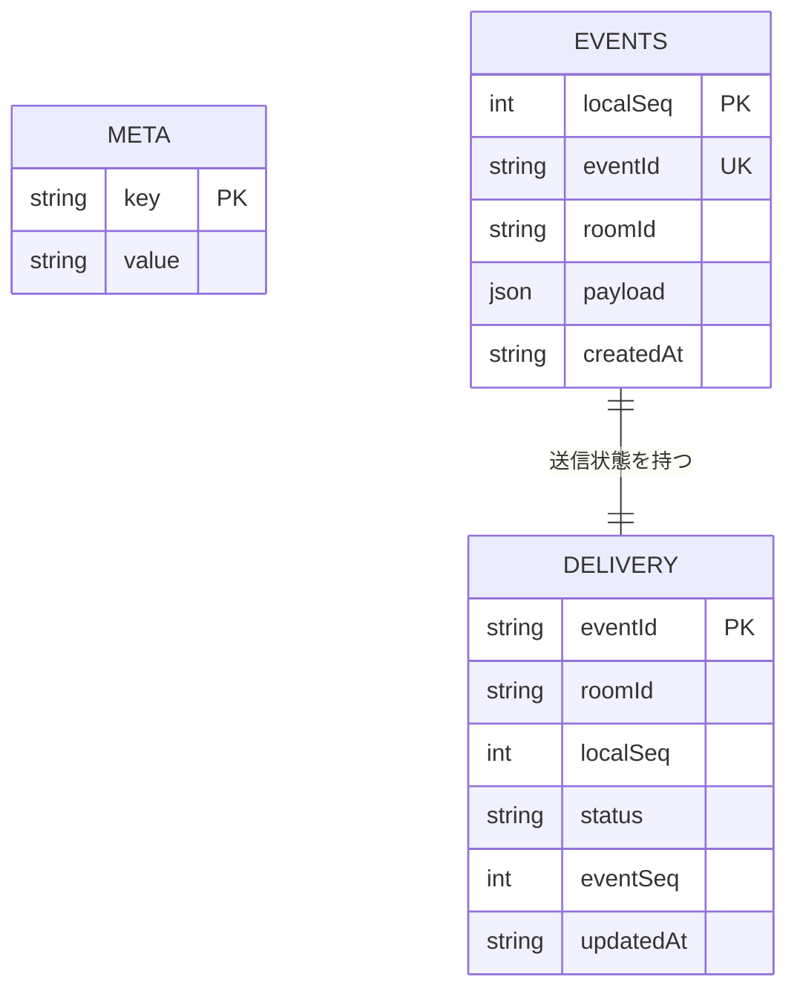

# データ構造・状態設計書（スキーマ・永続化・状態定義）
**対象端末（ブラウザ）の IndexedDB に保存する、イベントログと送信状態**

---

## 1. 概要とデータ管理方針

### 1.1 管理対象データの目的

- **管理対象**: Domain Store の追記型イベントログ（FR-01）と、各イベントの送信状態。
- **管理対象外**: 次のデータは永続化しない。
  - Control Store の制御状態と `controlSeq`: 接続のたびに IF-001（Pull）で取得するため（FR-04、BD D-06）。
  - サーバー（`relay`）の状態（Room、`controlSeq`、`eventSeq`、lease、presence）: v0.1 の `relay` は単体検証用で、状態をメモリで持つ。再起動で Room が失われると、`ROOM_NOT_FOUND` になる（DD §4.1）。サーバーの永続化は、本番用のサーバーを設計する時点で、別の DS として定める。
- **データ形式・文字コード・改行**: IndexedDB のレコード（構造化複製できる値）。文字列は UTF-8（JavaScript の文字列）。`payload` は JSON にシリアライズできる値だけを保存する。
- **時刻の基準**: UTC の ISO 8601 文字列。表示用で、順序の判断には使わない。
- **スキーマの正本形式**: 本書のフィールド表。
- **機密性・個人情報分類**: v0.1 は機密データを扱わない前提（BD §3.2）。`payload` に、認証情報や個人情報を入れない。暗号化とアクセス制御は #8 で定める。

### 1.2 データ境界 (DAO / 永続化ストレージ正本)

- **本書の正本範囲**: `persistent_data`。IndexedDB に物理保存されるデータの、構造と永続化契約。
- **DTOとの使い分け**: メモリ上の DTO（`SendBatch`、`sendFilter` など）は [DD](./CSU-DD-001_詳細設計書.md) を正本とする。
- **DDとの関係**: `StoragePort` の呼び出し順序と失敗時の動作は DD（F-001）を正本とし、本書は保存形式と永続化契約を定義する。
- **BDとの関係**: `StoragePort` の責務（追記、順序付きの読み出し、送信状態の更新）は BD（C-005、D-03）を正本とする。
- **IFとの関係**: サーバーへ送る形式は [IF/API仕様書](./CSU-IF-001_IF仕様書.md) を正本とする。外部から受け取った値のうち、保存するのは、サーバーが付けた `eventSeq` だけである。
- **責務の対象外**: スナップショット、ログの圧縮（#6）、OPFS（#5）、スキーマのアップキャスト（#7）。
- **矛盾時の扱い**: 該当する `ssot_scope` の正本を更新し、関連文書を追従させる。

### 1.3 ファイル配置および階層構造

| データ種別         | 相対パス / 命名規則                  | 保持内容                           | 所有者・アクセス権                                                               | 保持・バックアップ・復旧                                                                        |
| :----------------- | :----------------------------------- | :--------------------------------- | :------------------------------------------------------------------------------- | :---------------------------------------------------------------------------------------------- |
| データベース       | `csu-sync`（Room ごとに分けず、1つ） | 以下のオブジェクトストア。         | 同じオリジンのスクリプトだけがアクセスできる（ブラウザの同一オリジンポリシー）。 | 保持期間の上限は定めない（圧縮は #6）。バックアップは取らない。ブラウザのデータ削除で失われる。 |
| オブジェクトストア | `events`                             | ドメインイベントの追記型ログ。     | 同上。                                                                           | 追記だけで、更新と削除をしない。                                                                |
| オブジェクトストア | `delivery`                           | イベントごとの送信状態。           | 同上。                                                                           | 送信状態は、サーバーへの再送で再構築できる（`eventId` が冪等）。                                |
| オブジェクトストア | `meta`                               | スキーマバージョンなどの管理情報。 | 同上。                                                                           | 移行の判定に使う。                                                                              |

排他制御用のファイルはない。排他は、IndexedDB のトランザクションで行う（3.2）。

---

## 2. データ構造およびスキーマ定義 (Mermaid データモデル図)

### 2.1 エンティティ関係・データモデル構造 (Mermaid ER図)

`META` は、他のエンティティとの関係を持たない。

### 2.2 データモデル・フィールド仕様

#### `meta`

| JSONパス / フィールド名 | データ型 | 必須性 | NULL可 | デフォルト値 | 許容値・制約条件                                           | 互換性・移行メモ                           |
| :---------------------- | :------- | :----: | :----: | :----------- | :--------------------------------------------------------- | :----------------------------------------- |
| `key`                   | 文字列   |  必須  |  不可  | なし         | 主キー。v0.1 は `"storageVersion"` だけを使う。            | 管理情報を追加するときは、キーを追加する。 |
| `value`                 | 文字列   |  必須  |  不可  | なし         | `"storageVersion"` の値は、保存形式の版（v0.1 は `"1"`）。 | 4.1 の移行に使う。                         |

#### `events`

| JSONパス / フィールド名 | データ型 | 必須性 | NULL可 | デフォルト値     | 許容値・制約条件                                                                                                                                            | 互換性・移行メモ                           |
| :---------------------- | :------- | :----: | :----: | :--------------- | :---------------------------------------------------------------------------------------------------------------------------------------------------------- | :----------------------------------------- |
| `localSeq`              | 整数     |  必須  |  不可  | 追記時に自動採番 | 主キー。1 から始まり、追記のたびに増える。端末内の追記順を表す。再利用しない。                                                                              | 復元の順序は、この値で決める。             |
| `eventId`               | 文字列   |  必須  |  不可  | なし             | 一意（一意インデックス）。空でない。再送で変わらない。                                                                                                      | IF-002 の冪等性の根拠。                    |
| `roomId`                | 文字列   |  必須  |  不可  | なし             | 空でない。                                                                                                                                                  | v0.1 は、1つの端末が複数の Room を持てる。 |
| `payload`               | JSON     |  必須  |  不可  | なし             | JSON にシリアライズできる。`type`（文字列）が必須であることは、[DD §2.3](./CSU-DD-001_詳細設計書.md) を正本とする。サイズの上限は、IndexedDB の制限に従う。 | 形式の変更は、`storageVersion` で扱う。    |
| `createdAt`             | 文字列   |  必須  |  不可  | 追記時の時刻     | UTC の ISO 8601。                                                                                                                                           | 表示用。順序の判断には使わない。           |

#### `delivery`

| JSONパス / フィールド名 | データ型 | 必須性 | NULL可 | デフォルト値             | 許容値・制約条件                                                                 | 互換性・移行メモ                                                                                            |
| :---------------------- | :------- | :----: | :----: | :----------------------- | :------------------------------------------------------------------------------- | :---------------------------------------------------------------------------------------------------------- |
| `eventId`               | 文字列   |  必須  |  不可  | なし                     | 主キー。`events.eventId` に対応する。1対1。                                      | `events` と同じトランザクションで作成する（3.1）。                                                          |
| `roomId`                | 文字列   |  必須  |  不可  | `events.roomId` の複製   | `events.roomId` と同じ値。未送信のイベントを Room ごとに読み出すために複製する。 | 作成後は変更しない。IndexedDB のインデックスは、1つのストアの中のフィールドにしか張れないため、複製が必要。 |
| `localSeq`              | 整数     |  必須  |  不可  | `events.localSeq` の複製 | `events.localSeq` と同じ値。未送信のイベントを追記順に読み出すために複製する。   | 作成後は変更しない。                                                                                        |
| `status`                | 文字列   |  必須  |  不可  | `PENDING`                | `PENDING`（未送信）、`SENT`（サーバーが受理した）のいずれか。                    | `PENDING` → `SENT` の一方向だけ。戻さない。                                                                 |
| `eventSeq`              | 整数     |  任意  |   可   | NULL                     | `status` が `SENT` のとき、サーバーが付けた値。`PENDING` のときは NULL。         | Room 単位の順序（DD V-10）。端末では順序の判断に使わない。                                                  |
| `updatedAt`             | 文字列   |  必須  |  不可  | 作成時の時刻             | UTC の ISO 8601。                                                                | 監査用。                                                                                                    |

- `delivery` の状態は、`PENDING` と `SENT` だけである。`STALE_CONTROL_SEQ` で拒否されたイベントは `PENDING` のまま保持する（DD §3.2 のイベントの再評価）。
- 未送信のイベントは、`delivery` から `roomId` が指定した値で、`status` が `PENDING` のレコードを、`localSeq` の順に読み出し、対応する `events` を取得して得る。指定した `roomId` 以外のイベントは、読み出されない（Room の分離、FR-04）。

#### インデックス

| オブジェクトストア | インデックス名 | 対象フィールド                             | 一意性 | 用途                                                                                                             |
| :----------------- | :------------- | :----------------------------------------- | :----- | :--------------------------------------------------------------------------------------------------------------- |
| `events`           | `byEventId`    | `eventId`                                  | 一意   | 再送時の重複検出、`delivery` との対応付け。                                                                      |
| `delivery`         | `byRoomStatus` | `["roomId", "status", "localSeq"]`（複合） | 非一意 | Room ごとの未送信のイベントを、追記順に1回で取得する（`roomId` と `status` を固定し、`localSeq` の範囲で読む）。 |

---

## 3. 永続化・原子置換契約・排他制御

### 3.1 原子的書き込み契約 (Atomic Write Contract)

IndexedDB は、ファイルのような一時ファイルと置換を使わない。代わりに、トランザクションの原子性を使う。

1. **追記**（`StoragePort.append`）: `events` へのレコード追加と、`delivery`（`PENDING`。`roomId` と `localSeq` を複製）の作成を、**1つの読み書きトランザクション**で行う。どちらかが失敗した場合は、両方を取り消す（ブラウザが保証する）。
2. **送信状態の更新**（`StoragePort.markSent`）: `PENDING` → `SENT` の更新は、1つのトランザクションで、`eventSeq` と `updatedAt` と一緒に行う。
3. **完了の確認**: 呼び出し元への成功の通知は、トランザクションの `complete` イベントの後に行う。`abort` と `error` のときは、失敗を返す（DD F-001、`StoragePort` の失敗は状態を更新しない）。
4. **更新と削除の禁止**: `events` のレコードは、追記だけで、更新も削除もしない。更新できるのは、`delivery` の `status` と `eventSeq` と `updatedAt`（`PENDING` → `SENT` の一方向）だけで、`delivery` も削除しない。
5. **復旧確認**: データベースを開くときに、`meta.storageVersion` を読み、4.1 の判定を行う。`events` にあって `delivery` にないイベントがある場合は、1.のトランザクションが守っているため起こらない。起きた場合は、破損として扱い、エラーを返して、自動修復はしない。

- **文字コード・改行・スキーマバージョン**: UTF-8（JavaScript の文字列）。保存形式の版は `meta.storageVersion`。

### 3.2 排他制御仕様 (FileLock の代替)

ファイルのロックはない。複数のタブが同じデータベースを開く場合の排他は、次のとおりとする。

- **ロック対象**: `csu-sync` データベース全体。
- **ロック識別情報**: なし。IndexedDB のトランザクションが、同じオブジェクトストアへの読み書きを直列に実行する。
- **`localSeq` の採番**: 自動採番（`autoIncrement`）で、複数のタブから同時に追記しても、重複しない。
- **同じイベントの二重追記**: `byEventId` の一意制約が、`ConstraintError` で拒否する。呼び出し元は、すでに追記済みとして扱う。
- **ロック獲得待ち方針**: トランザクションの待ちは、ブラウザが管理する。アプリケーションはタイムアウトを持たない。
- **取得失敗時の処理**: 該当しない（ロックを取得しない）。トランザクションが `abort` または `error` になったときは、失敗を呼び出し元へ返す（3.1 の 3）。
- **stale lock の判定・回収**: 該当しない。
- **正常終了時の解放**: 該当しない。トランザクションの終了で、ブラウザが自動的に解放する。
- **異常終了・強制終了時の扱い**: 該当しない。タブの終了やブラウザの強制終了で、完了していないトランザクションは、ブラウザが取り消す。確定済みのデータだけが残る（3.1）。
- **バージョン変更時の扱い**: 別のタブが古い版のデータベースを開いている場合、`versionchange` イベントでその接続を閉じる。閉じない場合、移行は待たされる（`blocked`）。待たされたときは、エラーとして通知する。
- **複数のタブでの Sync Engine**: 同じ `roomId` と `targetId` で、複数のタブが同時に接続すると、presence と送信が重複する。v0.1 の暫定方針として、1つの `targetId` につき、1つのタブだけを前提とする。複数のタブの調停方式は、要件定義書の未決事項 OP-09 で管理する。

---

## 4. データライフサイクルと互換性保全

### 4.1 フォーマット移行と互換性ルール

| 移行元バージョン | 移行先バージョン | 実行契機                     | 変換内容・保持する旧フィールド                                        | ロールバック可否・方法 | 失敗時の扱い                                                                 |
| :--------------- | :--------------- | :--------------------------- | :-------------------------------------------------------------------- | :--------------------- | :--------------------------------------------------------------------------- |
| なし（新規）     | `"1"`            | データベースを初めて開くとき | ストアとインデックスを作成し、`meta.storageVersion` を `"1"` にする。 | 該当しない             | 作成に失敗したら、データベースを作らず、エラーを返す。                       |
| `"1"`            | `"1"`            | データベースを開くとき       | なし。                                                                | 該当しない             | なし。                                                                       |
| `"1"` より新しい | `"1"`            | データベースを開くとき       | 変換しない。                                                          | 該当しない             | **エラー停止する。** データを変更せず、親へ通知する（NFR-03 と同じ考え方）。 |

- **旧バージョン互換**: v0.1 は版が1つだけで、変換のルールはない。互換性の範囲を広げる変更（アップキャスト）は #7 で定める。
- **後方互換性維持**: 新しいフィールドを追加する場合は、未定義のフィールドを持つレコードを読み出したときに、既定値で補う。この方針を、移行の仕様として #7 で具体化する。

---

## 5. 作成完了チェック

- [x] `document_role`、`ssot_scope`、`status`、`owner`をFrontmatterへ設定した。
- [x] 管理対象、データ形式、文字コード、時刻基準、スキーマの正本形式を記入した。
- [x] 全エンティティがER図とフィールド仕様の双方に定義され、関係・カーディナリティが一致している。
- [x] 必須性、NULL可否、既定値、列挙値、制約、一意性を記入した。サイズ上限は IndexedDB の制限に従う。
- [x] データベースとストアの名前、所有者・アクセス権、保持、バックアップ・復旧を記入した。
- [x] 原子書き込みの契約を、IndexedDB のトランザクションに置き換えて記入した。
- [x] 排他制御（FileLock の代替）、バージョン変更時の扱い、複数のタブの前提を記入した。
- [x] バージョン移行、後方互換性、ロールバック、移行失敗時の扱いを記入した。
- [x] Mermaidのサンプルエンティティ・フィールド・関係および未置換の `[ ... ]` が残っていない。

---

## 6. 改訂履歴 (Change Log)

| 版数    | 改訂日     | 変更者 | 変更内容・変更理由 (Why)                                                                               |
| :------ | :--------- | :----- | :----------------------------------------------------------------------------------------------------- |
| Rev.1.0 | 2026-11-28 | xzyozi | 新規作成（初版制定）。BD が「DS で定める」とした、イベントログの保存形式と、原子性・排他の契約を確定。 |
